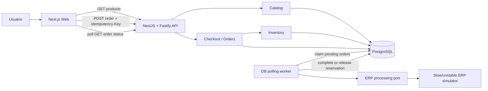

# CaseCellShop Checkout Fullstack

> Status: FINAL
> Readiness: READY WITH FOLLOW-UPS
> Tier: standard
> Version: 0.2
> Owner: Repository owner
> Created: 2026-08-10
> Last Updated: 2026-08-10

## Summary

Implementar um mini-projeto fullstack de checkout para compra de uma única capinha e quantidade por pedido. A solução usa Next.js/React no frontend, NestJS com adaptador Fastify no backend e PostgreSQL em Docker Compose.

O checkout não aguarda o ERP simulado. A API reserva estoque e cria um pedido de forma transacional, retorna rapidamente e um worker interno processa o pedido de forma assíncrona. Idempotência no backend evita pedidos duplicados; reservas atômicas evitam overselling; o frontend acompanha o status, diferencia erros e preserva estado para retry.

## Fonte e força dos requisitos

A única fonte disponível é `INSTRUCTIONS.md:1-74`.

- **Obrigatório:** fluxo fullstack com produto, quantidade, tentativa de compra e tratamento de sucesso, validação, estoque insuficiente, duplicidade e falha temporária (`INSTRUCTIONS.md:27-30`).
- **Critério de avaliação:** APIs, proteção de estoque, idempotência, simulação de ERP, estados de UI, documentação, testes e organização (`INSTRUCTIONS.md:34-55`).
- **Bônus incorporados:** diagrama, logs estruturados, consulta de status e teste de concorrência (`INSTRUCTIONS.md:55`).
- **Não exigido:** pagamento, autenticação, integração ERP real, cloud, mensageria real ou layout sofisticado (`INSTRUCTIONS.md:59-68`).

## Problem

A arquitetura descrita acopla a loja ao ERP monolítico por chamadas REST síncronas para catálogo, preço, estoque e faturamento (`INSTRUCTIONS.md:10-16`). Isso produz três falhas observadas:

1. A vitrine depende de uma fonte lenta (`INSTRUCTIONS.md:18`).
2. Compras concorrentes podem consumir o mesmo estoque (`INSTRUCTIONS.md:20`).
3. O checkout aguarda o ERP, sofre timeout e perde a compra (`INSTRUCTIONS.md:22`).

A evolução precisa ser incremental, com risco controlado e sem alterar ou reescrever o ERP (`INSTRUCTIONS.md:24-25`).

## Goals

- **FR-1 — Consultar produtos:** listar produtos disponíveis sem chamar o ERP simulado no caminho da requisição.
- **FR-2 — Criar pedido:** aceitar a compra de um produto e uma quantidade inteira positiva.
- **FR-3 — Validar entrada:** rejeitar payload, identificador, quantidade e chave de idempotência inválidos antes de mutar estado.
- **FR-4 — Reservar estoque atomicamente:** criar o pedido e reservar estoque em uma única transação PostgreSQL.
- **FR-5 — Evitar duplicidade:** associar cada submissão lógica a uma chave de idempotência única e reproduzir o pedido já criado sem nova reserva.
- **FR-6 — Processar assincronamente:** retirar a latência do ERP simulado do ciclo HTTP de criação do pedido.
- **FR-7 — Consultar status:** expor o estado atual e o resultado terminal do pedido.
- **FR-8 — Finalizar estoque:** converter a reserva em venda no sucesso ou liberá-la em falha temporária.
- **FR-9 — Permitir retry coerente:** reutilizar a mesma chave somente quando o resultado da requisição é desconhecido; usar nova chave após qualquer resposta explícita sem pedido ou após falha terminal.
- **FR-10 — Exibir experiência completa:** permitir seleção, quantidade, loading, bloqueio de múltiplos cliques e mensagens compreensíveis para todos os resultados exigidos.
- **FR-11 — Simular ERP:** oferecer atraso e resultado configuráveis e reproduzíveis, sem integração real.
- **FR-13 — Expor saúde:** informar se processo e banco estão prontos para atender.

## Non-Goals

- **NG-1:** carrinho com múltiplos itens ou múltiplos SKUs no mesmo pedido.
- **NG-2:** pagamento real.
- **NG-3:** autenticação, autorização ou gestão de clientes.
- **NG-4:** integração real com ERP ou alteração de seu MySQL, rotinas ou código.
- **NG-5:** broker de mensagens, Redis, Kafka ou mensageria de produção.
- **NG-6:** deploy em cloud, Kubernetes, alta disponibilidade ou benchmark de milhões de acessos.
- **NG-7:** sincronização real de catálogo/preço/estoque a partir do ERP.
- **NG-8:** layout sofisticado.

## Scope

### Incluído

- Monorepo `pnpm` com aplicações API e web.
- API e web como deployables independentes, sem pacote compartilhado ou imports cruzados; DTOs, interfaces e tipos de fronteira são duplicados intencionalmente em cada aplicação.
- API NestJS usando Fastify.
- Frontend Next.js com React.
- PostgreSQL local via Docker Compose.
- Migrações e seed determinístico.
- Catálogo local, pedido de item único, reserva de estoque e idempotência.
- Worker baseado em polling do PostgreSQL.
- Simulador ERP configurável.
- Consulta de status, health check, OpenAPI e logs JSON.
- Testes unitários, integração real com PostgreSQL, concorrência, frontend e smoke E2E.
- README, diagrama e `PROMPTS.md`.

### Fora do escopo

Todos os itens `NG-1`–`NG-8`, além de observabilidade distribuída real, SLOs de produção, expiração de reservas por abandono do cliente e reconciliação com ERP real. As respostas da Parte 1.A continuam obrigatórias para a entrega final, mas suas perguntas não foram fornecidas. O repositório público já existe; a URL ainda deve constar na resposta final.

## Existing Context

- **Estado do repositório:** Git em `main`, commit inicial `48d0c0b`, origin público `https://github.com/TakayukiKomatsu/casecellshop-checkout`; `README.md` contém apenas o título e `INSTRUCTIONS.md` está staged.
- **Arquitetura atual do case:** loja → REST síncrono → ERP monolítico → MySQL do ERP.
- **Restrição de integração:** o ERP e seu banco não podem ser alterados; o mini-projeto usa persistência própria.
- **Stack preferencial:** não informada em `INSTRUCTIONS.md`; a escolha aprovada deve ser explicada no README.
- **Parte 1.A:** as seis perguntas exigidas para a entrega final não estão presentes.

## Architecture



### Deployable e módulos

O backend é um modular monolith com um único deployable nesta entrega:

- **Catalog:** consulta a projeção local de produtos.
- **Checkout:** valida, aplica idempotência e coordena criação/reserva.
- **Inventory:** possui as regras e transições de estoque.
- **Orders:** possui o ciclo de vida e a consulta de pedidos.
- **ErpProcessing:** reclama trabalho pendente e coordena o port do ERP.
- **ErpSimulator:** adapter lento/instável, substituível.
- **Observability:** correlation ID, logs e health.

O worker roda no mesmo processo da API por simplicidade operacional e processa um pedido por vez. Seus contratos não dependem do transporte; ele pode ser extraído depois sem alterar o contrato HTTP ou as invariantes do domínio. Recuperação automática de um ERP call interrompido exige idempotência no ERP real e fica fora desta entrega.

## Users and Workflows

### Fluxo principal

1. Usuário abre a página e a web consulta `GET /api/products`.
2. Usuário escolhe um produto, informa quantidade e confirma.
3. A web gera uma UUID de idempotência e envia `POST /api/orders`.
4. A API valida e, em uma transação, reserva estoque e cria pedido `PENDING`.
5. A API retorna `202 Accepted` sem esperar o ERP.
6. A web consulta `GET /api/orders/{id}` enquanto o pedido está não terminal.
7. O worker reclama o pedido, chama o simulador e finaliza como `COMPLETED` ou `FAILED`.
8. A web exibe a mensagem correspondente e atualiza o catálogo.

### Retry de transporte

Se a web não sabe se o `POST` chegou ao servidor, repete o mesmo payload com a mesma chave. A API retorna o pedido original e não reserva novamente.

### Retry após falha temporária

`FAILED` é terminal e sua reserva já foi liberada. A tela mantém produto e quantidade. Um retry explícito gera nova chave e tenta criar um novo pedido, sujeito ao estoque atual.

## Proposed Behavior

### Modelo de status

- `PENDING`: pedido persistido e estoque reservado; aguarda worker.
- `PROCESSING`: worker reclamou o pedido e executa o port ERP.
- `COMPLETED`: ERP simulado confirmou; estoque reservado foi convertido em venda.
- `FAILED`: ERP simulado retornou falha temporária; reserva foi liberada.

Transições permitidas:

- `PENDING -> PROCESSING`
- `PROCESSING -> COMPLETED`
- `PROCESSING -> FAILED`

Estados terminais não podem voltar a estados não terminais.

### Invariantes de estoque

Para cada produto:

1. `stock_on_hand >= 0`.
2. `stock_reserved >= 0`.
3. `stock_reserved <= stock_on_hand`.
4. `available_stock = stock_on_hand - stock_reserved`.
5. Reserva e criação do pedido pertencem à mesma transação.
6. Sucesso decrementa `stock_on_hand` e `stock_reserved` pela quantidade do pedido na mesma transação.
7. Falha decrementa somente `stock_reserved` pela quantidade do pedido na mesma transação.
8. Nenhum caminho usa leitura seguida de atualização fora de lock/transação para decidir disponibilidade.

### Algoritmo de criação

1. Validar header e body.
2. Abrir transação e tentar inserir `idempotency_records(key, request_fingerprint)` com `ON CONFLICT DO NOTHING`.
3. Se a inserção perder a corrida, aguardar a transação vencedora, ler o registro, comparar a impressão e retornar o pedido existente ou conflito antes de consultar estoque.
4. Se a inserção vencer, bloquear a linha do produto, recalcular disponibilidade e reservar estoque.
5. Inserir o pedido `PENDING`, associá-lo ao registro de idempotência e confirmar tudo na mesma transação.
6. Qualquer erro ou estoque insuficiente reverte registro, pedido e reserva juntos.

### Algoritmo do worker

1. Em transação curta, selecionar um `PENDING` com `FOR UPDATE SKIP LOCKED`.
2. Marcar `PROCESSING`, gravar `processing_started_at` e confirmar a transação.
3. Executar o simulador fora de transação.
4. Em nova transação, finalizar somente se o pedido ainda estiver `PROCESSING`; a atualização condicional impede dupla finalização local.
5. Uma queda durante a chamada pode deixar o pedido `PROCESSING`. A recuperação automática fica para a integração real, quando o ERP aceitar uma operation key estável ou oferecer reconciliação.

### Contrato do simulador

- `ERP_SIMULATION_DELAY_MS` define um atraso fixo não negativo.
- `ERP_SIMULATION_MODE=success` confirma todos os pedidos.
- `ERP_SIMULATION_MODE=failure` falha todos os pedidos com `TEMPORARY_ERP_FAILURE`.
- `ERP_SIMULATION_MODE=scripted` consome `ERP_SIMULATION_SCRIPT` em ordem, por exemplo `failure,success`.
- O worker possui concorrência `1`; portanto a ordem do script é a ordem dos claims.
- O cursor do script começa no primeiro item ao iniciar o processo. Em testes, cada cenário recebe uma nova instância do simulador.
- O script é finito; tentar processar além de seu último item falha a configuração do cenário em vez de escolher resultado aleatório.
## Interfaces and Data

### `GET /api/products`

Resposta `200 OK`:

```json
{
  "items": [
    {
      "id": "uuid",
      "sku": "CASE-IP15-BLK",
      "name": "Capinha Impact iPhone 15",
      "description": "Proteção reforçada",
      "priceCents": 7990,
      "availableStock": 5
    }
  ]
}
```

O endpoint lê somente o PostgreSQL local e não chama o simulador ERP.

### `POST /api/orders`

Header obrigatório:

```http
Idempotency-Key: <uuid>
```

Body:

```json
{
  "productId": "uuid",
  "quantity": 2
}
```

Nova criação: `202 Accepted`, header `Location: /api/orders/{id}`:

```json
{
  "replayed": false,
  "order": {
    "id": "uuid",
    "productId": "uuid",
    "quantity": 2,
    "status": "PENDING",
    "failureCode": null,
    "createdAt": "ISO-8601",
    "updatedAt": "ISO-8601"
  }
}
```

Replay com mesma chave e conteúdo: `200 OK`, mesma forma, `replayed: true`. O estado pode já ter avançado.

### `GET /api/orders/{id}`

Resposta `200 OK`:

```json
{
  "id": "uuid",
  "productId": "uuid",
  "quantity": 2,
  "status": "FAILED",
  "failureCode": "TEMPORARY_ERP_FAILURE",
  "createdAt": "ISO-8601",
  "updatedAt": "ISO-8601"
}
```

### `GET /api/health`

- `200 OK` quando processo e banco estão prontos.
- `503 Service Unavailable` quando a consulta de prontidão ao banco falha.

### Envelope de erro

```json
{
  "code": "INSUFFICIENT_STOCK",
  "message": "Estoque insuficiente para a quantidade solicitada.",
  "correlationId": "uuid",
  "details": {
    "availableStock": 1
  }
}
```

Códigos:

| HTTP | `code` | Condição |
|---|---|---|
| 400 | `VALIDATION_ERROR` | Header/body inválido, ausente ou quantidade não inteira positiva |
| 404 | `PRODUCT_NOT_FOUND` | Produto inexistente |
| 404 | `ORDER_NOT_FOUND` | Pedido inexistente |
| 409 | `INSUFFICIENT_STOCK` | Quantidade excede disponibilidade transacional |
| 409 | `IDEMPOTENCY_KEY_REUSED` | Mesma chave com request diferente |
| 500 | `INTERNAL_ERROR` | Falha técnica inesperada no caminho síncrono |

### Dados persistidos

#### `products`

- `id uuid primary key`
- `sku text unique not null`
- `name text not null`
- `description text not null`
- `price_cents integer not null check (price_cents >= 0)`
- `stock_on_hand integer not null check (stock_on_hand >= 0)`
- `stock_reserved integer not null check (stock_reserved >= 0 and stock_reserved <= stock_on_hand)`
- timestamps

#### `orders`

- `id uuid primary key`
- `product_id uuid references products(id)`
- `quantity integer not null check (quantity > 0)`
- `status enum/text constrained to the four documented states`
- `failure_code nullable`
- `processing_started_at timestamptz nullable`
- timestamps

#### `idempotency_records`

- `key uuid primary key`
- `request_fingerprint text not null`
- `order_id uuid unique nullable references orders(id)`
- `created_at timestamptz not null`

O registro é criado e associado ao pedido na mesma transação. Uma resposta que não cria pedido reverte também o registro.

## Frontend State and UX

A página usa uma máquina de estados explícita por tentativa:

- `idle -> submitting -> tracking -> succeeded | failed`
- `tracking -> tracking_paused -> tracking`

- O botão de criar pedido fica desabilitado em `submitting`, `tracking` e `tracking_paused`.
- A seleção, quantidade, order ID e chave permanecem guardados enquanto existe pedido não terminal.
- Polling é encerrado em estado terminal, desmontagem ou timeout do cliente.
- Timeout leva a `tracking_paused`, exibe “pedido ainda em processamento” e habilita somente “Consultar novamente”, que faz `GET` para o mesmo order ID. Nenhum novo `POST` é permitido.
- Se a resposta do `POST` for desconhecida por falha de transporte ou `500 INTERNAL_ERROR`, uma repetição usa a mesma chave e payload; o backend pode então reproduzir o pedido ou executar novamente uma transação revertida.
- `VALIDATION_ERROR`, `PRODUCT_NOT_FOUND`, `INSUFFICIENT_STOCK` e `IDEMPOTENCY_KEY_REUSED` são respostas explícitas sem pedido; após correção ou nova submissão, a web gera nova chave.
- Replay idempotente informa que a tentativa existente está sendo acompanhada.
- `FAILED/TEMPORARY_ERP_FAILURE` mantém seleção/quantidade e habilita Retry com nova chave.
- `COMPLETED` exibe sucesso, atualiza produtos e redefine quantidade para `1`.
- Erro inesperado inclui correlation ID copiável para suporte.

## Edge Cases and Failure Handling

- Quantidade `0`, negativa, fracionária, string, ausente ou fora do inteiro seguro é inválida.
- UUID de produto ou idempotência malformada é inválida.
- Produto removido entre listagem e checkout retorna `PRODUCT_NOT_FOUND`.
- Estoque alterado entre listagem e checkout é decidido pelo valor bloqueado na transação, não pelo frontend.
- Dois pedidos com chaves diferentes disputando a última unidade produzem exatamente um pedido reservado.
- Duas submissões concorrentes com a mesma chave produzem exatamente um pedido e uma reserva.
- Reutilizar chave com produto ou quantidade diferente retorna conflito.
- Falha de banco antes do commit não cria pedido nem reserva parcial.
- Falha do simulador libera a reserva e registra estado terminal.
- Queda do processo durante simulação pode deixar um pedido `PROCESSING`; a limitação é documentada e não é mascarada por retry inseguro do ERP.
- Falha de polling não altera o pedido; a tela pausa tracking e só retoma `GET` do mesmo order ID.
- O simulador usa resultado fixo ou script finito ordenado; nenhum cenário ou teste depende de aleatoriedade.

## Risks and Constraints

- **NFR-1 — Correção concorrente:** as invariantes devem ser garantidas pelo PostgreSQL e comprovadas por teste concorrente real.
- **NFR-2 — Resiliência:** a criação do pedido não pode aguardar a conclusão do simulador ERP.
- **NFR-3 — Idempotência:** proteção deve existir no backend e sobreviver a múltiplas abas, retries e chamadas diretas.
- **NFR-4 — Observabilidade:** cada requisição recebe correlation ID e cada transição de pedido gera log JSON com order ID, estado anterior/novo, duração e código de falha.
- **NFR-5 — Reprodutibilidade:** seed e modos do simulador devem tornar sucesso e falha determinísticos.
- **NFR-6 — Manutenibilidade:** módulos devem expor responsabilidades claras; domínio não depende diretamente do simulador.
- **NFR-7 — Segurança básica:** validação por allowlist, SQL parametrizado/ORM, sem secrets versionados e sem dados sensíveis em logs.
- **NFR-8 — Experiência:** loading, bloqueio de submissão e mensagens devem refletir o estado persistido, não timers artificiais do frontend.
- **NFR-9 — Documentação:** README deve cobrir setup, decisões, limitações, próximos passos e verificação.
- **NFR-10 — Portabilidade:** PostgreSQL é a única infraestrutura obrigatória; Docker não deve ser necessário para API/web.
- **NFR-11 — Desempenho observável:** catálogo não chama ERP; teste prova que `POST /orders` retorna antes de uma chamada ERP bloqueada, sem impor threshold dependente da máquina.

Riscos aceitos:

1. Worker no mesmo processo compartilha destino de falha com a API.
2. Polling de banco não substitui uma fila durável em escala real.
3. Uma queda durante chamada ERP pode deixar pedido `PROCESSING`; recuperação segura depende de operation key idempotente ou reconciliação do ERP real.
4. Catálogo local não resolve sincronização real com o ERP.
5. O projeto demonstra padrões e invariantes, não capacidade para milhões de acessos.

## Rollout, Migration, and Rollback

### Inicialização local

1. Subir PostgreSQL por Docker Compose.
2. Validar variáveis de ambiente.
3. Executar migrações.
4. Executar seed idempotente.
5. Iniciar API/worker e web.

### Rollback local

- Reverter a última migração quando houver down migration segura.
- Em ambiente descartável, remover o volume e recriar banco/seed.
- Não há migração ou rollback no ERP; ele não é tocado.

### Evolução incremental

1. Substituir o simulador por adapter anti-corruption para o ERP.
2. Adicionar outbox transacional e broker.
3. Extrair worker para processo independente.
4. Construir projeção de catálogo alimentada por CDC/polling controlado do ERP.
5. Adicionar expiração/cancelamento de reserva e reconciliação.
6. Adicionar métricas, tracing, alertas e testes de carga.

## Observability

### Logs estruturados

Eventos mínimos:

- `http.request.completed`
- `order.created`
- `order.idempotency_replayed`
- `order.processing_started`
- `order.completed`
- `order.failed`

Campos mínimos: timestamp, level, event, correlationId, orderId quando aplicável, status anterior/novo, durationMs e failureCode. Chaves, payload completo e secrets não são logados.

### Métricas futuras

Não são implementadas nesta entrega. Próximos sinais: latência/erro por rota, idade de pedidos pendentes, pedidos por estado, taxa de falha ERP, reservas ativas, conflitos de estoque e replays idempotentes.

### Alertas futuros

- Pedido `PENDING/PROCESSING` acima do SLO.
- Crescimento contínuo da fila no banco.
- Aumento de falhas ERP.
- Falha de invariantes ou reconciliação de estoque.

## Acceptance Criteria

- **AC-1 (FR-1, NFR-11):** `GET /api/products` retorna seed com disponibilidade calculada e não chama o simulador ERP.
- **AC-2 (FR-2, FR-4):** request válido com estoque cria um único `PENDING`, reserva a quantidade e retorna `202` com `Location`.
- **AC-3 (FR-3):** entradas inválidas, incluindo campos/header ausentes, inteiro inseguro e UUID de path malformada, retornam `400 VALIDATION_ERROR` e não alteram pedidos ou estoque.
- **AC-4 (FR-4):** quantidade acima da disponibilidade retorna `409 INSUFFICIENT_STOCK` com disponibilidade atual e não cria pedido.
- **AC-5 (FR-4, NFR-1):** dois pedidos simultâneos com chaves diferentes disputando a última unidade resultam em um `202`, um `409` e nenhuma violação das invariantes.
- **AC-6 (FR-5, NFR-3):** duas chamadas concorrentes com a mesma chave/request e estoque igual a uma solicitação retornam um `202` e um `200` replay, o mesmo ID, um pedido e uma reserva.
- **AC-7 (FR-5):** repetir a chave com request diferente retorna `409 IDEMPOTENCY_KEY_REUSED` sem mutação.
- **AC-8 (FR-6, NFR-2):** com o simulador bloqueado, o POST retorna pedido aceito antes de a simulação terminar.
- **AC-9 (FR-8, FR-11):** modo success produz `COMPLETED` e decrementa `stock_on_hand` e `stock_reserved` exatamente uma vez.
- **AC-10 (FR-8, FR-11):** modo failure produz `FAILED/TEMPORARY_ERP_FAILURE` e libera `stock_reserved` sem decrementar `stock_on_hand`.
- **AC-11 (FR-7):** consulta retorna corretamente `PENDING`, `PROCESSING`, `COMPLETED` e `FAILED`, incluindo failureCode, e retorna `404 ORDER_NOT_FOUND` para UUID inexistente.
- **AC-13 (FR-10):** UI impede novo clique durante submissão/tracking e mostra loading.
- **AC-14 (FR-10):** UI mostra mensagens distintas para sucesso, validação, estoque insuficiente, duplicidade/replay e falha temporária.
- **AC-15 (FR-9, FR-10):** falha de transporte ou `500 INTERNAL_ERROR` reutiliza a mesma chave/payload; resposta de negócio explícita sem pedido ou `FAILED` usa nova chave em uma submissão deliberada.
- **AC-16 (FR-10):** após sucesso a UI atualiza disponibilidade e redefine quantidade; após erro mantém estado ajustável.
- **AC-17 (FR-13):** health retorna `200` com banco disponível e `503` sem prontidão do banco.
- **AC-18 (NFR-4):** transições geram logs JSON correlacionáveis por request e pedido sem payload sensível.
- **AC-19 (FR-11, NFR-5):** script `failure,success` gera exatamente falha no primeiro claim e sucesso no segundo após cada inicialização do simulador.
- **AC-20 (NFR-9):** README documenta execução, decisões, limitações, próximos passos e comandos de verificação; `PROMPTS.md` registra prompts relevantes.
- **AC-21 (FR-1, FR-2, FR-10):** no browser, produtos carregam, o usuário seleciona produto/quantidade e o POST contém exatamente os valores selecionados.
- **AC-22 (FR-7, FR-9, FR-10):** timeout de polling entra em `tracking_paused`, mantém order ID/chave, não cria pedido e “Consultar novamente” retoma somente o GET até estado terminal.
- **AC-23 (FR-3):** produto válido mas inexistente retorna `404 PRODUCT_NOT_FOUND` sem pedido, reserva ou registro de idempotência persistido.
- **AC-24 (FR-3, FR-4):** falha síncrona injetada antes do commit retorna `500 INTERNAL_ERROR` com correlation ID e reverte registro, pedido e reserva.

## Verification Plan

### Unit

- Validação de quantidade e IDs.
- Transições permitidas/proibidas.
- Cálculo de impressão idempotente.
- Mapeamento de erros e mensagens.
- Política de geração/reuso de chave no frontend.

### Integration

- API e repositories contra PostgreSQL real.
- Todos os status HTTP e envelopes.
- Reserva/finalização/liberação transacionais.
- Corridas de estoque e idempotência.
- Claim com `SKIP LOCKED` e guardas de finalização.

### Frontend

- Componentes e hooks com API controlada.
- Loading e bloqueio.
- Polling, tracking pausado e estados terminais.
- Mensagens e preservação/reset de formulário.
- Semântica de retry.

### End-to-end

- Caminho de sucesso pelo browser.
- Falha temporária seguida de retry bem-sucedido.
- Verificação de console sem erros inesperados e atualização de estoque.

### Operational checks

- Subida limpa a partir de clone com comandos do README.
- Migração e seed repetíveis.
- Health com banco ativo/inativo.
- Logs correlacionáveis por pedido.

## Decisions

| ID | Decisão | Motivo | Alternativas rejeitadas |
|---|---|---|---|
| DEC-1 | Mini-projeto production-shaped | Maximiza evidência de correção sem criar arquitetura distribuída fictícia | Fluxo mínimo em memória; blueprint amplo |
| DEC-2 | NestJS + Fastify + Next.js/React | Stack aprovada, TypeScript end-to-end e separação clara de API/UI | Fastify puro; Spring Boot |
| DEC-3 | PostgreSQL em Docker Compose | Semântica transacional e concorrência real | SQLite; DuckDB analítico |
| DEC-4 | Modular monolith | Menor superfície operacional com seams extraíveis | BullMQ/Redis; serviços separados + outbox |
| DEC-5 | Worker por polling no banco | Checkout assíncrono usando apenas PostgreSQL | Espera síncrona; broker real |
| DEC-6 | Falha libera reserva; retry cria pedido | Modelo terminal simples e demonstrável | Manter reserva com endpoint retry; retries automáticos |
| DEC-7 | Idempotência por chave no backend | Protege retries, múltiplas abas e chamadas diretas | Apenas botão desabilitado |
| DEC-8 | Pedido de item único | Satisfaz o case sem introduzir carrinho | Carrinho multi-item |
| DEC-9 | TypeORM com migrações | Integração convencional com Nest; transações reais serão testadas | Escolha de ORM deixada aberta |

## Open Questions and External Dependencies

Nenhuma questão aberta bloqueia implementação do mini-projeto.

- **OQ-1 — Parte 1.A:** obter as seis perguntas e respondê-las antes da entrega final. Owner: repository owner.
- **OQ-2 — Link final:** inserir `https://github.com/TakayukiKomatsu/casecellshop-checkout` no final da resposta de entrega. Owner: repository owner.
- **OQ-3 — Stack preferencial:** confirmar se havia uma preferência em material não presente; enquanto isso, documentar a escolha aprovada. Owner: repository owner.

## Change Log

| Version | Date | Summary |
|---|---|---|
| 0.1 | 2026-08-10 | Design aprovado convertido em SDD para revisão |
| 0.2 | 2026-08-10 | Aprovado como FINAL após corrigir idempotência concorrente, determinismo, tracking pausado, cobertura de erros e grounding; remove lease ERP inseguro |
| 0.2 (status de implementação) | 2026-08-11 | Tasks 1–8 entregues no commit consolidado `2138ea0` e Task 9 Steps 1–7 concluídas, sem alterar o comportamento aprovado. Verificador de aceitação, revisão de código após correções P1/P2 e revisão de segurança: APPROVE. Validação final: lint, typecheck e builds Nest/Next passaram; API 9 suites/45 testes, web 3 arquivos/33 testes e Playwright 3/3 passaram; `pnpm audit --prod` informou `No known vulnerabilities`. Correções finais: guard de submissão após resultado desconhecido, deadline absoluto do polling, seed não destrutivo, isolamento/token do scheduler, exaustão do script antes do claim e dependências corrigidas. O push do repositório e a publicação do link foram concluídos separadamente. Somente a Parte 1.A permanece bloqueada externamente porque suas seis perguntas não foram fornecidas. |
