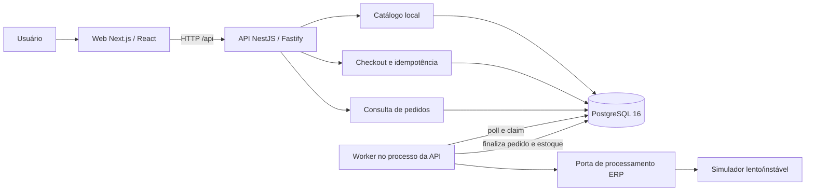
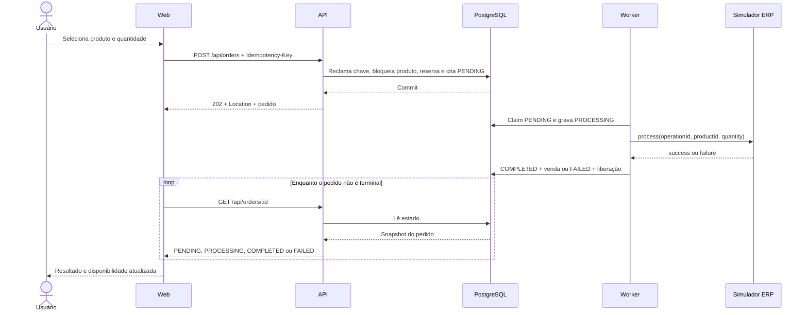

# CaseCellShop Checkout

Mini-projeto fullstack de checkout para uma capinha e uma quantidade por pedido. A solução mantém catálogo e estoque em PostgreSQL, aceita o pedido sem aguardar o ERP simulado e processa a reserva de forma assíncrona.

## Visão geral

- **Web:** Next.js 16.3.0 e React 19.2.8, em `http://localhost:3000`.
- **API:** NestJS 11 com Fastify 5.11.0, em `http://localhost:3001`.
- **Banco:** PostgreSQL 16 via Docker Compose.
- **Processamento:** worker por polling no PostgreSQL, no mesmo processo da API e com concorrência `1`.
- **Escopo:** um produto por pedido; sem pagamento, autenticação ou ERP real.

A API e a web são deployables independentes. Cada aplicação mantém seus próprios tipos de fronteira HTTP; não existe pacote compartilhado entre elas.

## Pré-requisitos

- Node.js 22 ou superior (`.nvmrc` fixa a versão 22);
- Corepack habilitado;
- pnpm 11.21.0, fixado no `package.json`;
- Docker com Docker Compose v2;
- portas locais `3000`, `3001` e `5432` livres.

## Instalação e execução local

Clone o repositório e prepare as dependências:

```bash
git clone https://github.com/TakayukiKomatsu/casecellshop-checkout.git
cd casecellshop-checkout
corepack enable
pnpm install --frozen-lockfile
cp .env.example .env
```

Suba o PostgreSQL, aplique a migração e carregue o catálogo determinístico:

```bash
docker compose up -d postgres
pnpm db:migrate
pnpm db:seed
```

Inicie API, worker e web em um único terminal:

```bash
pnpm dev
```

Para observar os processos separadamente, use dois terminais:

```bash
# Terminal 1 — API e worker
pnpm --filter api dev
```

```bash
# Terminal 2 — web
pnpm --filter web dev
```

Depois da inicialização:

- checkout: <http://localhost:3000>
- health: <http://localhost:3001/api/health>
- Swagger UI, fora de produção: <http://localhost:3001/api/docs>
- OpenAPI JSON, fora de produção: <http://localhost:3001/api/docs-json>

Para encerrar apenas o banco:

```bash
docker compose down
```

O volume `postgres_data` preserva os dados entre reinicializações.

## Configuração

A API e o worker carregam o arquivo `.env` da raiz. Valores já definidos no ambiente do processo têm precedência. Reinicie a API após alterar o modo do simulador.

| Variável | Padrão em `.env.example` | Semântica |
|---|---|---|
| `DATABASE_URL` | banco `casecellshop` em `localhost:5432` | Conexão usada pela API, worker, migração e seed locais. |
| `DATABASE_URL_TEST` | banco `casecellshop_test` em `localhost:5432` | Banco isolado usado pelas suítes e pelo E2E. Deve ser diferente de `DATABASE_URL`. |
| `WORKER_POLL_MS` | `100` | Intervalo inteiro não negativo entre tentativas de claim do worker. |
| `ERP_SIMULATION_DELAY_MS` | `1000` | Atraso fixo, em milissegundos, antes do resultado simulado. Aceita inteiro não negativo. |
| `ERP_SIMULATION_MODE` | `success` | Resultado fixo `success`, resultado fixo `failure` ou sequência `scripted`. |
| `ERP_SIMULATION_SCRIPT` | `failure,success` | Lista finita, ordenada e separada por vírgulas. É obrigatória e validada quando o modo é `scripted`. |
| `NEXT_PUBLIC_API_URL` | `http://localhost:3001` | Origem da API usada pela web. É opcional e não pertence ao contrato da API no `.env` raiz. |

O processo falha na inicialização se as URLs não forem PostgreSQL, se os intervalos forem negativos, se o modo for inválido, se o script configurado for inválido ou se os bancos local e de teste forem iguais.

## Receitas do simulador ERP

Os comandos abaixo usam as demais variáveis do `.env` e substituem somente a configuração indicada para o processo da API.

### Todos os pedidos concluem com sucesso

```bash
ERP_SIMULATION_MODE=success \
ERP_SIMULATION_DELAY_MS=1000 \
pnpm --filter api dev
```

O pedido passa por `PENDING -> PROCESSING -> COMPLETED`; a reserva vira venda.

### Todos os pedidos falham temporariamente

```bash
ERP_SIMULATION_MODE=failure \
ERP_SIMULATION_DELAY_MS=1000 \
pnpm --filter api dev
```

O pedido passa por `PENDING -> PROCESSING -> FAILED`, recebe `TEMPORARY_ERP_FAILURE` e libera a reserva sem reduzir o estoque físico.

### Primeira tentativa falha e o retry conclui

```bash
ERP_SIMULATION_MODE=scripted \
ERP_SIMULATION_SCRIPT=failure,success \
ERP_SIMULATION_DELAY_MS=1000 \
pnpm --filter api dev
```

Cada claim consome um item da sequência. Como o worker processa um pedido por vez, o primeiro pedido falha e um retry explícito cria um segundo pedido que conclui. O cursor volta ao primeiro item quando a API é reiniciada. Consumir além do fim do script gera erro, em vez de escolher um resultado aleatório.

Em outro terminal, mantenha a web em execução:

```bash
pnpm --filter web dev
```

## API

Todas as rotas de negócio usam o prefixo `/api`.

| Método | Rota | Resultado principal | Erros relevantes |
|---|---|---|---|
| `GET` | `/api/products` | `200` com `{ items }`; `availableStock` é calculado no PostgreSQL. | `500 INTERNAL_ERROR` |
| `POST` | `/api/orders` | `202` para novo `PENDING`; `200` para replay idempotente; ambos incluem `Location`. | `400 VALIDATION_ERROR`, `404 PRODUCT_NOT_FOUND`, `409 INSUFFICIENT_STOCK`, `409 IDEMPOTENCY_KEY_REUSED`, `500 INTERNAL_ERROR` |
| `GET` | `/api/orders/:id` | `200` com o estado persistido do pedido. | `400 VALIDATION_ERROR`, `404 ORDER_NOT_FOUND`, `500 INTERNAL_ERROR` |
| `GET` | `/api/health` | `200 { "status": "ok" }` quando o banco responde. | `503 SERVICE_UNAVAILABLE` |
| `GET` | `/api/docs` | Swagger UI em ambiente não produtivo. | Não exposta com `NODE_ENV=production`. |
| `GET` | `/api/docs-json` | Documento OpenAPI em ambiente não produtivo. | Não exposta com `NODE_ENV=production`. |

### Criação do pedido

`POST /api/orders` exige uma UUID no header `Idempotency-Key`:

```http
Idempotency-Key: 7be46b56-3bf4-4dda-8dce-709ffc507587
Content-Type: application/json
```

```json
{
  "productId": "00000000-0000-4000-8000-000000000001",
  "quantity": 2
}
```

`quantity` deve ser um inteiro positivo seguro. Campos extras, valores ausentes e UUIDs inválidas são rejeitados antes de qualquer mutação.

### Checkout, estoque e status

1. A API valida header e body.
2. Em uma transação PostgreSQL, ela reclama a chave de idempotência, bloqueia o produto, verifica a disponibilidade, reserva o estoque e cria o pedido `PENDING`.
3. A API retorna `202 Accepted` sem aguardar o simulador ERP.
4. O worker reclama um `PENDING` com `FOR UPDATE SKIP LOCKED`, grava `PROCESSING` e chama o simulador fora da transação.
5. Em sucesso, o pedido vira `COMPLETED` e `stock_on_hand` e `stock_reserved` diminuem pela quantidade.
6. Em falha temporária, o pedido vira `FAILED`, recebe `TEMPORARY_ERP_FAILURE` e somente `stock_reserved` diminui.

Estados possíveis:

| Estado | Significado |
|---|---|
| `PENDING` | Pedido persistido, com estoque reservado, aguardando o worker. |
| `PROCESSING` | Worker reclamou o pedido e está chamando o adapter ERP. |
| `COMPLETED` | Simulador confirmou e a reserva foi convertida em venda. |
| `FAILED` | Simulador falhou temporariamente e a reserva foi liberada. |

### Idempotência e retry

- A mesma chave com o mesmo `productId` e `quantity` retorna o pedido original com `200` e `replayed: true`; não cria nova reserva.
- A mesma chave com conteúdo diferente retorna `409 IDEMPOTENCY_KEY_REUSED`.
- Se o resultado do `POST` for desconhecido por falha de transporte ou `500 INTERNAL_ERROR`, a web repete a mesma chave e o mesmo payload.
- Depois de uma resposta explícita sem pedido (`400`, `404` ou `409`), uma nova submissão gera uma nova chave.
- `FAILED` é terminal. O retry mantém produto e quantidade, mas gera nova chave e cria outro pedido sujeito ao estoque atual.
- A web consulta o mesmo pedido a cada segundo. Após 30 segundos ou três falhas consecutivas de consulta, pausa o tracking; “Consultar novamente” retoma somente `GET /api/orders/:id`, sem novo `POST`.

## Arquitetura



O backend é um monólito modular. Catálogo, checkout, inventário, pedidos, processamento ERP e observabilidade têm responsabilidades separadas, mas compartilham um único deployable da API. PostgreSQL é a única infraestrutura obrigatória.

## Sequência do checkout



## Decisões técnicas e questões da entrega

| ID | Decisão ou situação | Resposta |
|---|---|---|
| `OQ-1` | Parte 1.A | **Bloqueio externo:** as seis perguntas conceituais não existem nos artefatos fornecidos. Elas não foram inventadas; ainda precisam ser obtidas e respondidas antes da entrega externa. |
| `OQ-2` | Repositório público | **Concluído:** o repositório foi publicado em `https://github.com/TakayukiKomatsu/casecellshop-checkout`. |
| `OQ-3` | Preferência de stack | O material disponível não informa uma stack preferencial. A solução usa TypeScript ponta a ponta com Next.js/React e NestJS/Fastify; PostgreSQL fornece locks, transações e constraints reais para estoque e idempotência. |

Outras escolhas:

- **Monólito modular:** preserva fronteiras internas sem introduzir serviços e operação distribuída desnecessários para o case.
- **Worker por polling no PostgreSQL:** remove a latência do ERP do request usando somente a infraestrutura local exigida.
- **TypeORM com migrações e `synchronize: false`:** mantém o schema versionado e explícito.
- **Idempotência no backend:** protege retries, múltiplas abas e chamadas diretas; desabilitar o botão sozinho não seria suficiente.
- **Reserva transacional:** estoque e pedido são alterados juntos sob lock para evitar overselling.
- **Adapter ERP substituível:** o simulador demonstra atraso e instabilidade sem acoplar o domínio a uma integração fictícia.

## Verificação

A implementação das Tasks 1–8 foi consolidada no commit `2138ea0 feat: implement resilient checkout flow` (93 arquivos).

### Sequência limpa observada

| Etapa | Resultado observado |
|---|---|
| `pnpm install --frozen-lockfile` | **PASS** |
| `docker compose up -d postgres` | **PASS** |
| `pnpm db:migrate` | **PASS** |
| `pnpm db:seed` | **PASS** |
| `pnpm lint` | A primeira execução encontrou 89 diagnósticos na API. Eles foram reparados sem suppressions; a nova execução passou em API e web. |
| `pnpm typecheck` | **PASS** em API e web. |
| `pnpm test` | **PASS** — API: 9 suites e 45/45 testes; web: 3 arquivos e 33/33 testes. |
| `pnpm build` | **PASS** — NestJS e Next.js. |
| `pnpm e2e` | **PASS** — 3/3 cenários Playwright: sucesso, falha scripted seguida de retry e tracking pausado retomado somente por consultas. |
| `pnpm audit --prod` | **PASS** — `No known vulnerabilities`. |

O bootstrap da API e a Swagger UI usam versões compatíveis e corrigidas: Fastify `5.11.0`, `@nestjs/platform-fastify` `^11.1.29` e `@fastify/static` `^10.1.2`. Next.js está em `16.3.0` e React em `19.2.8`.

Comandos exercitados na sequência:

```bash
pnpm install --frozen-lockfile
docker compose up -d postgres
pnpm db:migrate
pnpm db:seed
pnpm lint
pnpm typecheck
pnpm test
pnpm build
pnpm e2e
pnpm audit --prod
```

### Revisões independentes e correções finais

- verificador de aceitação: **APPROVE**;
- revisão de código: **APPROVE**, após correção de todos os itens P1/P2;
- revisão de segurança: **APPROVE**.

As correções finais adicionaram o guard da submissão principal após resultado desconhecido, deadline absoluto do polling, seed não destrutivo, isolamento/token do scheduler nos testes, verificação de exaustão do script antes do claim e atualização das dependências vulneráveis. A validação completa foi repetida depois desses ajustes.

### Smoke direto da API

Os comandos documentados foram exercitados:

```bash
curl -fsS http://localhost:3001/api/health
curl -fsS http://localhost:3001/api/products
```

Resultados observados:

- health retornou `{ "status": "ok" }`;
- catálogo retornou os três produtos do seed, com `availableStock` inicial `8`, `3` e `0`.

### Smoke manual no browser

Em `http://localhost:3000`:

1. O fluxo de sucesso reduziu a disponibilidade do primeiro produto de `8` para `7` e exibiu `Compra concluída com sucesso.`.
2. Após reiniciar a API com `ERP_SIMULATION_MODE=scripted` e `ERP_SIMULATION_SCRIPT=failure,success`, a primeira tentativa exibiu `O processamento falhou temporariamente. Tente novamente.`.
3. O retry explícito concluiu com sucesso e reduziu a disponibilidade do primeiro produto de `7` para `6`.

### Entrega ainda pendente

- obtenção e resposta das seis perguntas da Parte 1.A.

## Limitações

- Uma queda durante a chamada ao ERP pode deixar o pedido em `PROCESSING`. Não há retry automático inseguro; recuperação exige uma operation key idempotente no ERP real ou reconciliação.
- Worker e API compartilham o mesmo processo e destino de falha.
- Polling no PostgreSQL não substitui uma fila durável para escala de produção.
- O catálogo local não possui sincronização real com o ERP/MySQL.
- Não há ERP real, pagamento, autenticação, autorização, broker de mensagens, cloud, alta disponibilidade ou observabilidade distribuída.
- Não há expiração de reservas abandonadas nem reconciliação.
- O projeto demonstra invariantes e fluxos localmente; não comprova capacidade para milhões de acessos.
- O pedido contém um único produto; não existe carrinho multi-item.

## Próximos passos

1. Obter e responder as seis perguntas da Parte 1.A.
2. Integrar o ERP por uma camada anticorrupção com operation key idempotente e reconciliação.
3. Adicionar outbox transacional, broker e worker em processo independente.
4. Alimentar o catálogo local por CDC ou polling controlado do ERP.
5. Implementar expiração/cancelamento de reservas e reconciliação de estoque.
6. Adicionar métricas, tracing, alertas, SLOs e testes de carga.

## Repositório

<https://github.com/TakayukiKomatsu/casecellshop-checkout>
